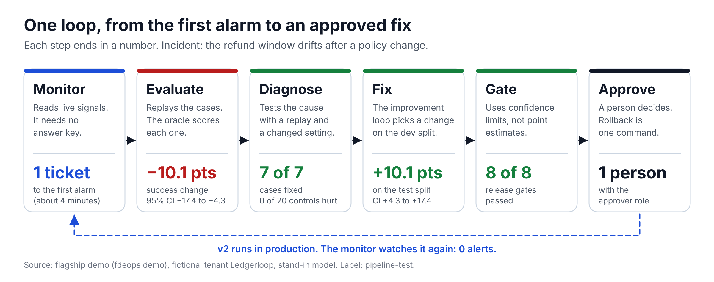
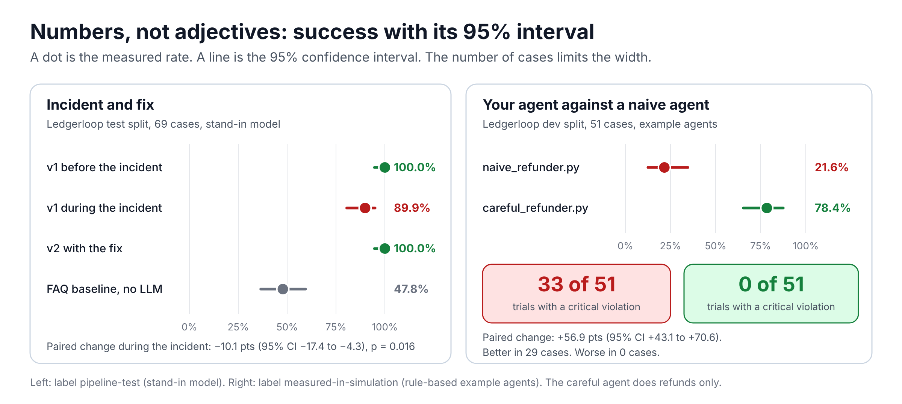
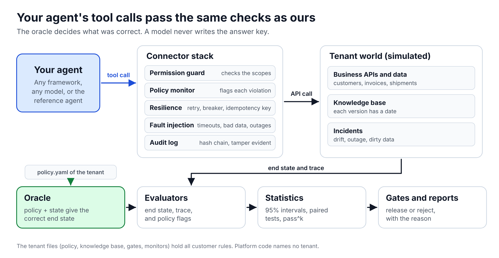
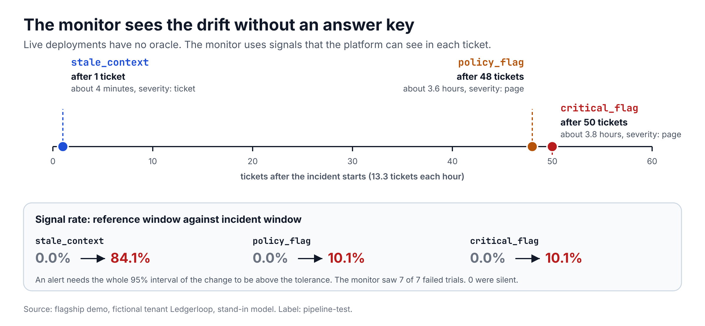
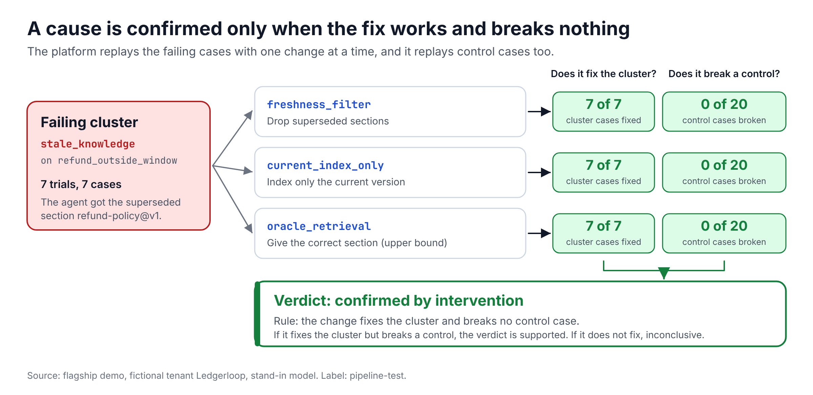
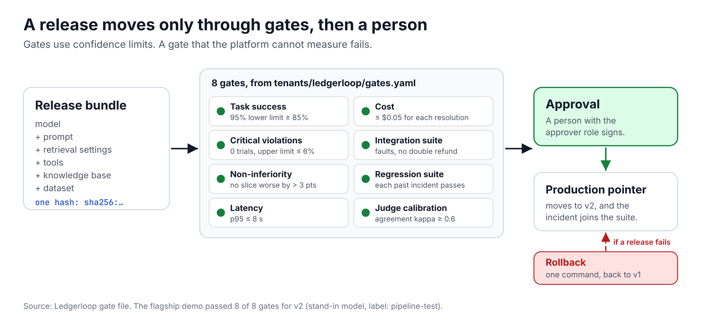
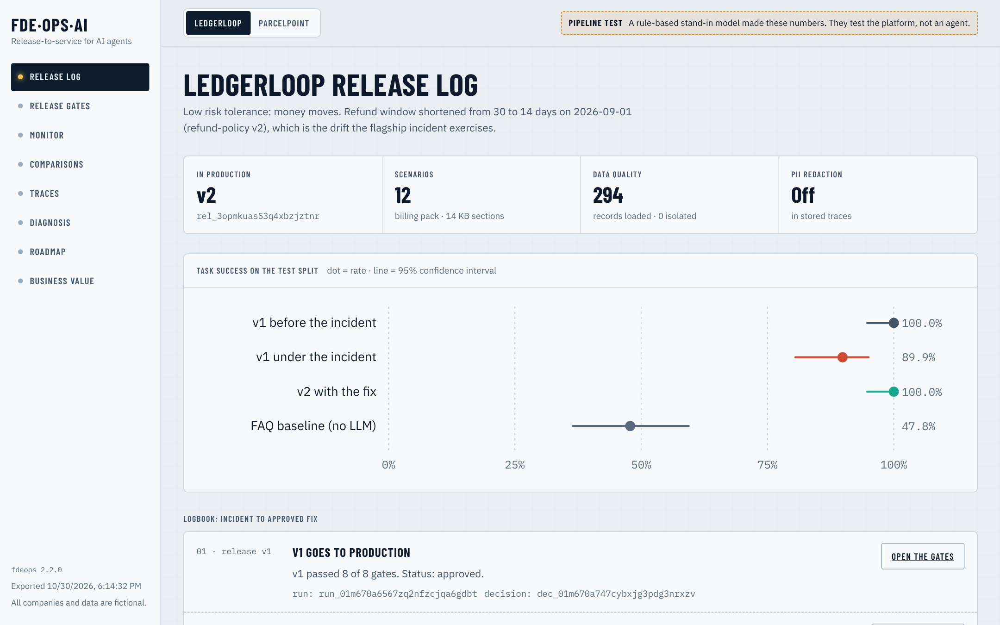
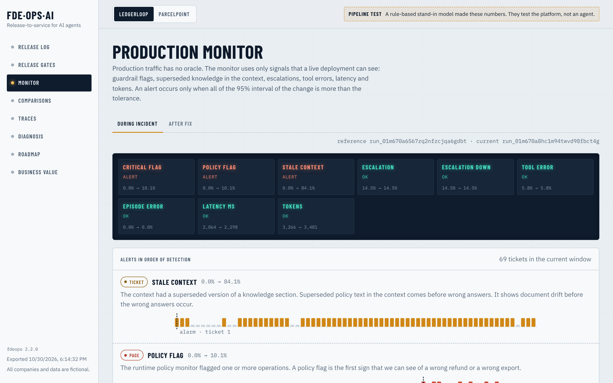

<div align="center">

# FDE-Ops-AI

**Deploy AI agents into real business workflows. Find each failure, prove its cause, and release a fix only when cost, latency and risk stay in limits.**

[](https://github.com/YashhMahajan/FDE-Ops-AI/actions/workflows/ci.yml)
[](LICENSE)
[](pyproject.toml)
[](tests)
[](pyproject.toml)

</div>



A demo shows that an agent can answer one question correctly. FDE-Ops-AI answers the questions that come after the demo:

- Does the agent do the task correctly in many realistic cases and in adversarial cases?
- Does the agent obey the policies and permissions of this customer?
- When a document changes or an API stops, can we find the problem, find the cause and prove the fix?
- Is the new release better than the current release? Can statistics show that the difference is real?

It is a toolkit for the work of a forward deployed engineer. You put the data of a customer in a folder of files. You connect your agent. The platform tests the agent, monitors it, finds the cause of each failure, and controls each release.

> All companies, persons and data in this repository are **fictional**. Each report shows the source of its numbers: `pipeline-test`, `measured-in-simulation` or `estimated`. We do not show simulated results as real customer results.

## The result in numbers



| Measure | Value | Source |
|---|---:|---|
| Task success of v1 when the refund policy drifts | 100.0% to 89.9% (95% CI 80.5% to 95.0%) | flagship demo, `pipeline-test` |
| Time to the first alarm of the production monitor | 1 ticket, about 4 minutes | flagship demo, `pipeline-test` |
| Cause confirmed by intervention | 7 of 7 cases fixed, 0 of 20 control cases broken | flagship demo, `pipeline-test` |
| Task success of v2 after the fix | 100.0% (95% CI 94.7% to 100.0%) | flagship demo, `pipeline-test` |
| Release gates passed by v2 | 8 of 8 | flagship demo, `pipeline-test` |
| Naive example agent against the careful example agent | 21.6% to 78.4% success, 33 to 0 critical trials | `measured-in-simulation` |
| Tests, and the lines of test code against the lines of source code | 450+ tests, 7,000 against 16,000 lines | `make check` |
| Statement coverage of the tests | 94% | `make check` |

The numbers with the label `pipeline-test` come from a rule-based stand-in model. They test the platform. They do not measure an agent. Refer to [real model runs](docs/guides/real-model-runs.md) to replace them with real numbers.

## How it works

### Your agent uses the same tools as ours

An external agent is one Python function. Each tool call goes through a permission guard and a policy monitor. Retries use an idempotency key. Fault injection and an audit log with a hash chain are also in the path. An oracle calculates the correct result from the policy of the customer. An LLM does not write the correct answer.



### The monitor finds the problem without an answer key

Live traffic has no oracle. The monitor uses only signals that it can see: guardrail flags, superseded knowledge in the context, escalations, tool errors, latency and tokens. An alert needs all of the 95% interval of the change to be more than the tolerance.



### A cause is confirmed only by an intervention

The platform replays the failing cases with one change at a time. It also replays control cases. A cause is `confirmed by intervention` only when the change fixes the cluster and breaks no control case. A fix without this proof is `supported` or `inconclusive`.



### A release moves only through gates, then a person

A release is a frozen bundle with one hash. Eight gates examine it, and each gate has an explanation in the tenant file. A gate that the platform cannot measure fails. A person with the approver role makes the decision, and a rollback is one command.



### The web UI shows the evidence





## Start

You must have Python 3.11 (or a subsequent version) and [uv](https://docs.astral.sh/uv/). You do not need a GPU, Docker or an API key for these steps.

```bash
uv sync
uv run fdeops doctor                         # check your machine
make check                                   # lint, types, layers, docs, tests

# The flagship demo: release, incident, monitor alarm, diagnosis, gated fix, approval, ROI
uv run fdeops demo --tenant tenants/ledgerloop --export web/public/demo
uv run fdeops demo --tenant tenants/parcelpoint --export web/public/demo

# The portfolio documents from the demo records
uv run fdeops portfolio
```

The web UI reads the export. Build it, and open `web/out/index.html` with a static file server:

```bash
cd web && pnpm install && pnpm build
```

## Use it on your own workflow

Make a tenant for your company, and test your own agent against it. You need about 15 minutes for the [quickstart](docs/guides/quickstart.md).

```bash
uv run fdeops init tenants/<your-tenant> --pack billing --name "<Your Company>"
```

Then write the policy and the knowledge base of your company.

Refer to [test your own agent](docs/guides/test-your-own-agent.md) to run your agent in the same tests as the reference agent. The example `careful_refunder.py` reads the policy. On the 51 dev cases of the fictional tenant, it has a success rate of **78.4%** (95% CI 65.4% to 87.5%) and **0** critical violations. The example `naive_refunder.py` does not read the policy. It has **21.6%** (95% CI 12.5% to 34.6%) and **33** trials with a critical violation. The paired difference is +56.9 points (95% CI +43.1 to +70.6), and the careful agent is better in 29 cases and worse in 0 cases.

These are the commands for each step of the workflow:

| Step | Command |
|---|---|
| Set up | `fdeops doctor`, `fdeops init`, `fdeops tenant validate`, `fdeops dataset build` |
| Evaluate | `fdeops run`, `fdeops compare` |
| Monitor production | `fdeops monitor REFERENCE_RUN CURRENT_RUN --tenant tenants/ledgerloop` |
| Find the cause | `fdeops diagnose RUN --tenant ... --dataset ...` |
| Fix and release | `fdeops improve`, `fdeops release propose`, `fdeops release approve`, `fdeops release rollback` |
| Business value | `fdeops impact`, `fdeops opportunities` |
| Regression in CI | `fdeops regress evals/regression.yaml` |
| Service | `fdeops serve`, `fdeops worker`, `fdeops keys create` |

The base package (`pip install fdeops`) runs all commands except the service commands. The service commands need the package group `fdeops[server]`.

Real model runs are free with OpenRouter free models or with vLLM on a free Kaggle GPU. Refer to [real model runs](docs/guides/real-model-runs.md).

To deploy the service, set `POSTGRES_PASSWORD` and use `docker compose up -d --build` on a server, or use the Render blueprint in `render.yaml`. CI starts the full Compose stack and runs a job through it.

## What the platform does

| Area | Function |
|---|---|
| Simulated world | Two fictional tenants: *Ledgerloop* (billing SaaS, 120 cases, 12 scenarios) and *Parcelpoint* (shipping SaaS, 114 cases, 11 scenarios). Each has a versioned knowledge base with effective dates, business data and APIs. A policy engine is the oracle. |
| Integration layer | Timeouts, retries, a circuit breaker, a rate limit and **idempotency keys**. A permission guard, a policy monitor, an audit log with a hash chain and fault injection. A REST connector from YAML, and an adapter for external agents. |
| Models | One client for the OpenAI-compatible protocol, with free presets: **OpenRouter free models**, vLLM and Ollama. **Cassettes** record each model call. A replay costs nothing. |
| Evaluation | Deterministic evaluators against the oracle, calibrated LLM judges, Wilson intervals, paired comparisons at case level, slices, pass^k and power calculations. |
| Production monitor | Signals that a live deployment can see, **without an oracle**. A sequential detector gives the number of tickets before the alarm. |
| Diagnosis | A taxonomy of 14 failure classes, clusters and **counterfactual interventions**. |
| Releases | Frozen release bundles, gates on confidence limits with an explanation for each gate, an integration suite with faults, shadow mode, approval by a person and rollback. |
| Improvement loop | Selects a fix on the dev split, validates it on the test split, and stops for approval. |
| Business value | ROI as a distribution against a person and against a FAQ baseline. Ranked opportunities and a roadmap memo. |
| Service | FastAPI with API keys and roles, a tenant scope on each request, a job queue in Postgres, Docker and Compose. |
| Web UI | A static Next.js UI: release log, gates, monitor, comparisons, traces, diagnosis, roadmap and business value. |

The mission: deploy AI agents into business workflows, evaluate them, find production failures, find the causes, and make the agents better. Cost, latency and risk must stay in the limits of each customer. The [portfolio index](docs/portfolio/README.md) connects each part of the mission to the code and the tests.

## Production readiness

We reviewed the code for the defects that occur frequently in code that an AI wrote and nobody examined. Each defect below has a test that failed before the fix.

| Defect | What it did | Fix, and the measured result |
|---|---|---|
| The base install crashed | `pip install fdeops`, then `fdeops version` raised `ModuleNotFoundError`, because a service module needed packages that the base install does not have. | Imports are lazy. A CI job installs the wheel into a clean environment and runs the commands. |
| A slow job ran two times | A job longer than its lease ran again on a second worker: 2 runs for 1 job. | A heartbeat extends the lease: 1 run. |
| A stale worker overwrote the result | A worker that did not have the lease could save its result. | Only the holder of the lease can save a result. |
| The rate limiter leaked memory | 200,000 different clients left 200,000 buckets (43.2 MB), and the number had no limit. | A limit on the table: 1,983 buckets (0.5 MB). A client that the limiter refuses keeps its bucket. |
| Concurrent writes failed | 7 of 8 writers to one run file failed with `FileNotFoundError`. | Unique temporary file, `fsync` and an atomic rename: 0 of 8 fail. |
| A provider error stopped the run | A model service that answered HTTP 200 with an error in the body raised `KeyError`. | The error is typed and retryable. The retries use jitter. |
| An upstream response had no size limit | A connector read an endless response into memory. | The connector stops at 2 MB (a setting). |
| A dead database connection failed a request | After Postgres started again, the first requests used connections that were closed. | The pool tests each connection (`pool_pre_ping`) and recycles it. SQLite uses WAL. |
| The Compose file had a default password | The password of Postgres was `fdeops`, and the ports were open on all interfaces. | Compose refuses to start without `POSTGRES_PASSWORD`. Ports use only `127.0.0.1`. The containers drop all capabilities, have a read-only file system and a memory limit. |
| A CI job could hang for hours | No job had a timeout. | Each job has a timeout, and a new job tests the wheel. |
| Generated documents showed numbers that were not correct | 4 numbers in the portfolio documents did not match the code. | A test compares the committed documents with a new run. |
| A wrong setting gave a stack trace | `FDEOPS_RATE_PER_MINUTE=lots` stopped the start with a traceback. A limit of `0` or `nan` was accepted. | A clear message, and a check of each limit. |

| Area | Where |
|---|---|
| Operations: deploy, roll back, backups, keys, incidents, service levels | [runbook](docs/operations/runbook.md) |
| All settings | [configuration reference](docs/operations/configuration.md) and `.env.example` |
| Threats, controls and the risks that stay | [threat model](docs/operations/threat-model.md) |
| Data, PII, model providers, retention and deletion | [data and privacy](docs/operations/data-and-privacy.md) |
| How to report a vulnerability | [security policy](SECURITY.md) |
| How to change the code | [contributing](CONTRIBUTING.md) and the [rules for behavior](CODE_OF_CONDUCT.md) |

CI examines each change with these checks:

- lint with security rules, types and the layer contract,
- tests on Python 3.11 and 3.12 with a minimum coverage, and the same storage tests on Postgres,
- a clean install of the wheel without extras, the Docker stack, and the web build with accessibility checks,
- dependency audits, license checks and a secret check of the git history,
- a check that each command in the documents runs, and that the generated documents show the numbers of the code.

## Layout

```
src/fdeops/
  core/        IDs, canonical hashes, clocks, provenance, atomic file writes, configuration errors
  llm/         protocol, OpenAI-compatible client, presets, retries, cassettes
  trace/       spans (OpenTelemetry GenAI attribute names), cost estimates
  retrieval/   versioned knowledge base, BM25, hashing embedder, hybrid retriever
  world/       entity state and diffs, cases, datasets, scenario framework
  connectors/  connector interface, resilience, guard, audit, faults, policy monitor
  packs/       domain packs (billing, logistics): entities, APIs, policy, scenarios, rule-based model
  tenancy/     tenant configuration as code
  agent/       reference support agent, prompts, episode runner
  eval/        evaluators, judges, calibration, runner, reports, comparisons, statistics
  monitor/     production monitor without an oracle: signals, detection, reports
  diagnose/    failure taxonomy, clusters, counterfactual interventions
  release/     release bundles, gates, integration suite, registry, shadow mode, memos
  improve/     the improvement loop
  impact/      costs, measured outcomes, FAQ baseline, ROI
  insights/    opportunities and the roadmap memo
  storage/     database, artifact store, tenant-scoped repository, API keys
  jobs/        job queue in the database and the worker
  api/         FastAPI service
  demo/        the flagship demo, the web export and the portfolio documents
  devtools/    the text checker for documents
  templates/   starter tenant files that `fdeops init` copies
  cli/         the `fdeops` command
tenants/       one folder for each fictional customer (policy, KB, gates, monitors, costs)
incidents/     incidents as YAML files, for each tenant
configs/       agent configurations (release candidates)
evals/         the regression manifest and the cassettes
web/           the Next.js UI
docker/        images for the API, the worker and the web UI
kaggle/        the notebook that records real model runs on a free GPU
docs/          design, plans, guides, glossary, diagrams and the portfolio documents
scripts/       checks for the documents, and the scripts that make the diagrams
```

An import-linter contract makes sure that each layer imports only from the layers below it. CI runs this contract.

## Status

Version 2.3 has milestones 0 to 10, the kit to use the platform on your own workflow, and a review for production readiness. Refer to the [release notes](https://github.com/YashhMahajan/FDE-Ops-AI/releases) and the [system design](docs/design/2026-10-18-fde-ops-ai-design.md).

| Milestone | Scope | Needs |
|---|---|---|
| Milestone 11 | Real recorded runs and a benchmark with real numbers | A free OpenRouter key or a free Kaggle GPU |
| Milestone 12 | A public demo | A decision by the owner of the repository |

## Contribute

Read [contributing](CONTRIBUTING.md). Run `make check` before you open a pull request. A change needs a test that fails without the change. To remake the diagrams, run `python3 scripts/make_diagrams.py` and `node scripts/render_diagrams.mjs`.

If this project saves you time, a star helps other engineers to find it.

## License

MIT
